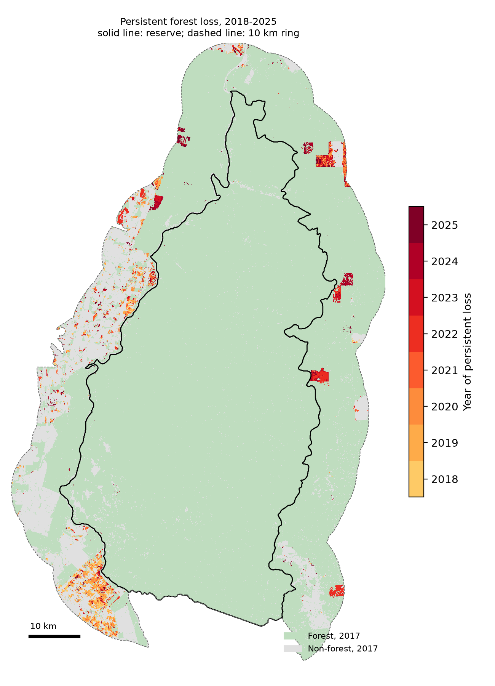
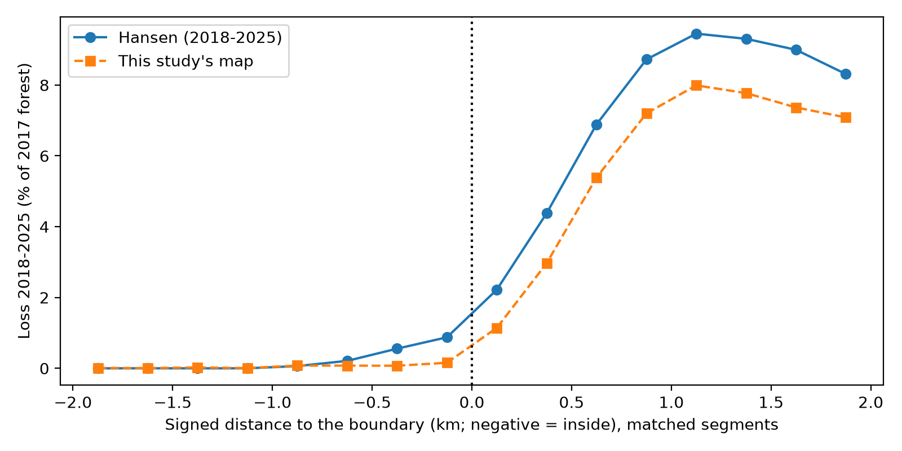
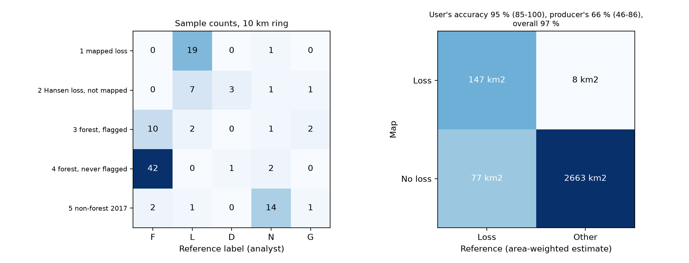

# Does protection slow deforestation? Jaru Biological Reserve, Brazil (2017-2025)

A Sentinel-1/2 and Google Earth Engine case study comparing forest loss inside a strictly protected area with forest loss in a 10 km ring around it. Loss is mapped with a random forest and a persistence rule, and its uncertainty is estimated from an independent, analyst-labelled validation sample following Olofsson et al. (2014).



## Question and answer in brief

**Question.** Is forest loss lower inside the Jaru Biological Reserve (Rondônia, IUCN category Ia) than in the unprotected land around it, and how robust is that contrast?

**Short answer.** Between 2018 and 2025 about one tenth of the 2017 forest was lost in the ring, whereas no loss was found in the sampled stable forest of the reserve. The difference is large and persists after a simple control for exposure to the deforestation front. It is an association for a single site, not proof that protection caused it.

## Key results

| Quantity | Ring (10 km) | Reserve |
|---|---|---|
| Forest loss 2018-2025, estimated from the validation sample | 224 km² (95 % CI 144 to 305) | about 3 km² (0 to 9); 0.2 km² if only confident labels are kept |
| Forest in 2017 | 2,196 km² (2,024 to 2,368) | 3,436 km² |
| Cumulative loss rate (loss / 2017 forest) | 10.2 % (6.8 to 13.6), about 1.3 % per year on average | about 0.1 %; analytic interval 0 to 0.27 %, but see the note below |
| Mapped loss (before correction) | 155 km² | 0.5 km² |
| Hansen GFC, for comparison | 162.6 km² (7.4 %) | 1.8 km² (0.05 %) |

**Accuracy of the loss map in the ring** (95 % bootstrap intervals): user's accuracy 95 % (85 to 100), producer's accuracy 66 % (46 to 86), overall accuracy 97 % (94 to 99). The map is reliable where it reports loss, but it misses about a third of the true loss, mostly small or marginal events.

**Reserve: how to read the numbers.** No loss was found in the 55 sample points of its large stable stratum, so the analytic interval is too narrow. A conservative 95 % upper bound of its loss is about 6 % of its forest. The loss of the reserve cannot be measured precisely with a sample of this size; the independent Hansen estimate there is very small.

**Distance to the boundary** (Hansen, 250 m bands, matched boundary segments). Loss is almost nil beyond 1 km inside the reserve and about 9 % beyond 1 km outside. The transition is a ramp of roughly 1 km on each side of the line rather than a step.



**Equal exposure.** The reserve's forest is mostly far from the deforestation front (more than two thirds is over 5 km away), whereas the ring's forest is mostly close to it. Comparing within classes of distance to the nearest external non-forest, the reserve would be expected to lose about 0.9 % of its forest if it had the ring's rates (0.05 % observed), and about 2.6 % on the classes present in both zones (0.13 % observed). That is roughly 17 to 20 times less than expected. Exposure explains most of the raw gap in percentage points, but not all of the relative difference.



## Method

1. **Site.** Strict categories (Ia, II) among 119 Brazilian protected areas of the arc of deforestation, created before 2013; Jaru was retained for its contrast and its forested ring.
2. **Composites.** Dry-season (May to September) medians of Sentinel-2 NDVI and NBR (cloud-masked with the scene classification) and Sentinel-1 VV and VH backscatter (descending orbit), for each year 2017-2025.
3. **Classification.** One random forest (200 trees, probability output) trained on 9,000 high-confidence Hansen points pooled over all years, applied to every year.
4. **Loss rule.** A pixel is lost in year *Y* if it is forest in 2017 and non-forest (probability below 0.3) from *Y* to 2025. Loss patches smaller than 6 pixels (0.54 ha) are removed. Both parameters were fixed before the validation.
5. **Validation.** 220 points drawn at random in 10 strata (5 map-based strata in each of the two zones), labelled blind from Sentinel-2 chips by one analyst, then area and accuracy estimated with the stratified estimators of Olofsson et al. (2014).
6. **Inside versus outside.** Loss rate by signed distance to the boundary, and comparison at equal exposure with a direct standardisation.

Hansen Global Forest Change is used for training labels and as an independent comparison, never as validation truth.

## Data

- World Database on Protected Areas (UNEP-WCMC and IUCN), polygon boundaries.
- Sentinel-2 L2A (harmonised) and Sentinel-1 GRD, Copernicus, through Google Earth Engine.
- Hansen et al. Global Forest Change v1.13 (2000-2025).

The `data/` folder is not versioned. It is rebuilt by the notebook (training samples, exported probability rasters, strata, validation points and labels). Check the terms of the source datasets before redistributing derived data.

## Repository

```
forest_protection.ipynb   the full analysis, in numbered steps 1 to 9
figures/                  figures produced by the notebook
data/                     generated locally, not versioned
```

## Reproducing the analysis

1. Create the environment and a Google Earth Engine account (noncommercial use) with a Google Cloud project.

   ```
   conda create -n forest-eo python=3.11 -c conda-forge
   conda activate forest-eo
   conda install -c conda-forge earthengine-api pandas numpy scipy scikit-learn matplotlib rasterio ipywidgets jupyterlab ipykernel
   python -m ipykernel install --user --name forest-eo
   ```

2. Set your project ID in the environment variable `EE_PROJECT` (or edit `PROJECT` in step 1.1) and open the notebook.
3. Steps 1 to 6.4 use Earth Engine. The steps that consume quota (5.2 training samples, 6.3 exports, 7.3 image chips) run only when their switch in step 1.1 is `True`; otherwise results saved in `data/` are reused. Each yearly export used roughly 5,000 to 6,700 EECU-seconds; the noncommercial monthly quota is 540,000.
4. Download the ten exported GeoTIFFs from Google Drive into `data/exports/`. From step 6.5 onwards the analysis is local.
5. Step 7.4 is an interactive labelling tool. The labels used in this study are an analyst's judgements and cannot be regenerated; to repeat the validation, draw a new sample (step 7.2) and label it.
6. After restarting the kernel, re-run 1.1, 6.5, 6.6, 6.7, 6.8 and 7.1 in this order before any later step.

## Limitations

- **One site, chosen for its contrast.** The result applies to this reserve and ring, not to protection in general. Where reserves are created, and the positional accuracy of their boundaries, can contribute to the inside/outside difference.
- **Association, not causation.** Exposure is controlled only through a coarse distance to the nearest external non-forest, which includes rivers and natural openings. Roads, slope, land tenure and enforcement are not controlled.
- **Training labels come from Hansen** and carry its errors; the validation does not use Hansen.
- **One analyst, about 30 minutes for 220 points**, no repeat labelling to measure consistency, only 10 points marked as hesitant.
- **Small samples in thin strata** (10 to 20 points): standard errors are approximate and a few points weigh heavily. For example, one point in the ring's non-forest stratum represents about 39 km², or 17 % of the estimated ring loss.
- **Small and transient events** (below 0.54 ha, or recovering within a year) are not mapped. A single-year non-forest flag is mostly a false alarm in the reserve, so such events cannot be recovered from the annual maps.
- **Timing.** In 2025 a single non-forest year counts as loss because no later year can confirm it; the dry-season composites can also shift the year attributed to a loss compared with Hansen's calendar year. Annual loss in 2024-2025 differs between the two products, and the cause was not established.
- **2017-2018** rest on about four times fewer acquisition days than later years.

## References

- Hansen, M.C. et al. (2013). High-resolution global maps of 21st-century forest cover change. *Science*, 342, 850-853.
- Olofsson, P., Foody, G.M., Herold, M., Stehman, S.V., Woodcock, C.E., Wulder, M.A. (2014). Good practices for estimating area and assessing accuracy of land change. *Remote Sensing of Environment*, 148, 42-57.

## Licence and author

Code: MIT licence (see the `LICENSE` file). Text and figures: please cite this repository.

Author: Noé Brière-Adriani, ENSG Nancy. Contact: [github.com/noe-briere-adriani](https://github.com/noe-briere-adriani).
